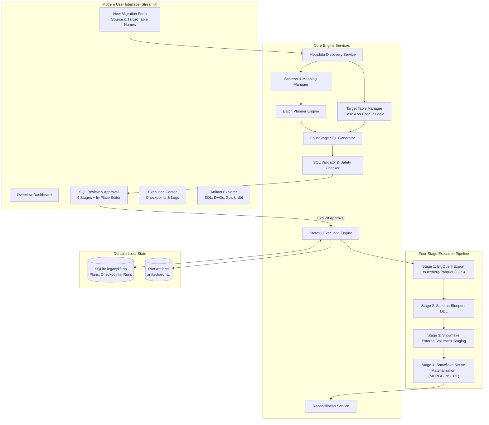

# LegacyLift Technical Architecture Specification

## 1. Executive Summary

**LegacyLift** is an automated historical data migration platform engineered to streamline the transfer of enterprise analytical datasets from **Google BigQuery** to **Snowflake** using **Apache Iceberg on Google Cloud Storage (GCS)** as an open staging catalog and interoperability standard.

The core premise of LegacyLift is **minimal user friction with zero guesswork**:
- The operator specifies only two inputs during standard operation: BigQuery source table name and Snowflake target table name.
- The platform automatically discovers schema definitions, row counts, partition keys, clustering strategies, access scopes, and existing target table states.
- The platform compiles a 4-stage SQL migration plan, plans deterministic batch segments, records durable checkpoints, and runs end-to-end data reconciliation.

---

## 2. System Architecture Diagram

---

## 3. The Four-Stage Data Migration Pipeline

LegacyLift avoids arbitrary monolithic migrations by decomposing historical data movement into four distinct, auditable stages:

### Stage 1: BigQuery Historical Export to Apache Iceberg / Parquet in GCS
- Generates native BigQuery `EXPORT DATA OPTIONS (format='PARQUET', uri='gs://.../*.parquet')` or BigLake Iceberg table creation SQL.
- Partitions large datasets deterministically into batch boundaries using BigQuery partition columns (`_PARTITIONDATE`, `DATE`, `TIMESTAMP`) or integer primary key ranges.
- Applies source-level column transformations (e.g. `UPPER`, `TRIM`, `COALESCE`).

### Stage 2: Schema Blueprint DDL
- Generates target schema contract DDL mapping BigQuery types (`INT64`, `NUMERIC(38,9)`, `TIMESTAMP`, `JSON`) to Snowflake native types (`NUMBER(38,0)`, `NUMBER(38,9)`, `TIMESTAMP_NTZ`, `VARIANT`).
- Defines primary keys and nullability constraints.
- Used as the reference blueprint for downstream dbt source models.

### Stage 3: Snowflake External Volume & Staging Integration
- Establishes Snowflake `EXTERNAL VOLUME` pointing to the GCS Iceberg directory.
- Configures Snowflake `STAGE` with `STORAGE_INTEGRATION` to read the staged Parquet files directly from GCS without intermediary downloading.
- Exposes staged data via an external table view for immediate SQL accessibility.

### Stage 4: Snowflake Native Table Materialization (Conditional DDL + Ingestion)
- **Mandatory Existing-Table Logic**:
  - **Case A (Target does not exist)**: Generates `CREATE TABLE IF NOT EXISTS <target> (...)` and includes it in the plan.
  - **Case B (Target already exists)**: **Suppresses redundant CREATE TABLE statements**. Reuses the existing table definition, compares schemas for compatibility, and executes `MERGE INTO` (deduplication) or `INSERT INTO`.
- Incorporates final row-count verification and checksum queries.

---

## 4. Batch Planning, Checkpoints & Recovery

1. **Deterministic Sizing**: Workloads with millions of records are partitioned into discrete chunks based on source partition metadata.
2. **Durable Checkpoints**: As each batch completes, its checkpoint (`PENDING` -> `IN_PROGRESS` -> `COMPLETED`) is committed to the local SQLite database.
3. **Safe Resume Semantics**: In the event of a transient network failure or timeout, the user can click **Resume Interrupted Migration**. The execution engine queries past checkpoints and **skips already completed batches**, guaranteeing zero duplicate ingestion.
4. **End-to-End Parity Reconciliation**: Compares source row count against target materialized row count and computes a parity percentage score.
